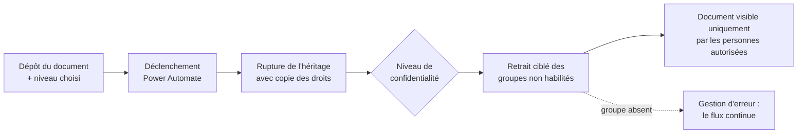

## Contexte et problème

L'administration passait d'un partage de documents dispersé à un espace SharePoint commun. La direction a soulevé un risque : un document sensible déposé dans un espace partagé héritait des permissions du site et devenait visible par des personnes non habilitées. Il fallait garantir que chaque document ne soit accessible qu'aux personnes autorisées, sans intervention manuelle.

## Mon rôle

J'ai mené le projet seul de bout en bout : analyse du besoin, conception de la solution, présentation et validation auprès du DSI, développement, tests sur un environnement bac à sable, puis déploiement en production.

## Solution et architecture

Lors du dépôt, l'auteur choisit un niveau de confidentialité parmi trois. Un flux Power Automate applique alors automatiquement les permissions correspondantes. Trois groupes, un par niveau, regroupent les utilisateurs habilités, du plus restreint (direction) au plus ouvert (ensemble des agents).

## Difficulté principale

Le compte d'exécution du flux n'avait pas les droits d'administrateur de collection : l'attribution de nouvelles permissions échouait. Plutôt que de demander une élévation de privilèges, j'ai inversé la logique : copier les permissions existantes, puis retirer uniquement les groupes non autorisés. J'ai aussi géré le cas où un groupe à retirer n'est pas présent sur le document, pour que le flux ne s'arrête pas.

## Résultat

Mis en production en environ 5 jours : 3 jours d'analyse et de conception, validation par le DSI, 1 jour de développement et de tests sur un site bac à sable, puis déploiement sur la bibliothèque réelle le lendemain. La solution est en usage depuis juin 2026.

## Ce que j'ai appris

- Trouver une solution sûre dans le cadre des droits existants, selon le principe du moindre privilège.
- Le modèle de permissions SharePoint en profondeur, y compris la différence entre les identifiants de groupes SharePoint et ceux d'Entra ID, source d'une erreur que j'ai dû diagnostiquer.
- Concevoir un flux robuste aux cas imprévus, pas seulement au cas idéal.
