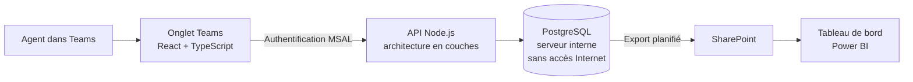

## Contexte et problème

L'établissement menait un programme de digitalisation d'une quinzaine de processus métier. Ces processus étaient gérés entièrement à la main dans des fichiers Excel : erreurs de saisie, rapports rédigés manuellement, suivi difficile et nombreux allers-retours entre services.

## Mon rôle

J'ai participé en équipe à l'état des lieux et à la cartographie des processus. J'ai ensuite pris en charge 6 processus, et j'ai conçu, développé et mis en production seul 5 applications :

- suivi des recommandations d'audit interne ;
- suivi des recommandations des corps de contrôle externes ;
- suivi des recommandations du conseil d'administration et des comités de suivi ;
- suivi des créances, avec tableau de bord Power BI ;
- suivi et traitement des heures supplémentaires.

## Solution et architecture

Chaque application est intégrée à Microsoft Teams sous forme d'onglet. Les agents s'y connectent avec leur compte Microsoft 365, sans nouvel identifiant.

## Difficultés principales

**Des exigences métier qui évoluaient.** J'ai géré ces changements par des itérations courtes : écoute des utilisateurs, questions pour approfondir le besoin, remise en question des demandes, proposition de solutions, validation par le métier, démonstration, puis déploiement. La DSI suivait chaque étape.

**Un serveur de données sans accès Internet.** Power BI ne pouvait pas se connecter directement à la base. Les solutions d'ouverture du serveur étaient trop risquées pour cette infrastructure. J'ai mis en place un export automatique vers SharePoint, auquel Power BI est connecté : export planifié chaque soir, recalcul des données chaque matin, et un bouton de synchronisation à la demande pour les mises à jour urgentes. Résultat : un tableau de bord à jour, sans jamais exposer le serveur.

## Résultat

- Fin des fichiers Excel pour les processus couverts.
- Plusieurs centaines de recommandations reprises et suivies dans les applications.
- Exports automatiques, fin des erreurs de saisie et des allers-retours.
- Retours très positifs des auditeurs et des entités auditées sur le gain de temps.
- Livré dans les délais d'une mission de 15 mois. Mise en service progressive depuis septembre 2026.

## Ce que j'ai appris

- Un processus se comprend et se cartographie avant d'être digitalisé : c'est ce diagnostic qui a permis un développement rapide.
- Travailler directement avec le métier et présenter les solutions aux utilisateurs.
- Le coût de la duplication : j'ai dérivé une application d'une autre par copie. Je concevrais aujourd'hui un socle commun pour les applications de suivi de recommandations.
- Utiliser l'IA comme accélérateur de développement, en gardant la maîtrise de l'architecture et la relecture du code.
