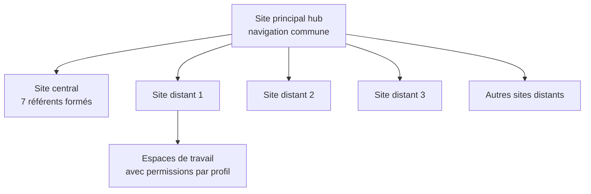

## Contexte et problème

L'administration disposait de SharePoint, mais l'outil était vide et mal utilisé. Chaque agent partageait ses documents depuis son propre espace cloud, sans structure commune ni contrôle des accès. Il fallait mettre en place un intranet structuré, l'enrichir de fonctionnalités, et surtout amener les agents à l'utiliser.

## Mon rôle

- À partir d'un modèle défini par mon responsable, j'ai construit 3 des sites distants : structure, navigation, pages et espaces de travail avec des permissions adaptées à chaque profil.
- J'ai ajouté des fonctionnalités : notifications automatiques lors de l'ajout ou de la suppression d'éléments (Power Automate), et un agenda partagé pour chaque entité, consultable par les autres pour coordonner les programmes (Outlook).
- J'ai conçu et animé seul la formation de 7 cadres du site central, chargés ensuite d'accompagner les autres agents.

## Solution et architecture

Un site principal (hub) centralise la navigation, et chaque entité dispose de son propre site rattaché. Les utilisateurs naviguent dans un intranet unique, et chaque entité garde la maîtrise de ses espaces.

## Difficulté principale

L'adoption par des utilisateurs peu habitués à SharePoint. J'ai produit des supports de formation, mené des démonstrations sur des cas réels, puis accompagné les référents après la formation, jusqu'à ce qu'ils soient autonomes.

## Résultat

- Une dizaine de sites rattachés à un intranet unique, dont 3 construits par moi.
- 7 cadres formés et autonomes, devenus référents pour environ une dizaine d'agents par site.
- Livré et mis en production fin 2025.

## Ce que j'ai appris

- L'écosystème Microsoft 365, découvert lors de cette première mission.
- Concevoir et animer une formation de formateurs, et prendre la parole devant des cadres.
- Un projet technique ne réussit que si les utilisateurs l'adoptent : la formation fait partie de la livraison.
